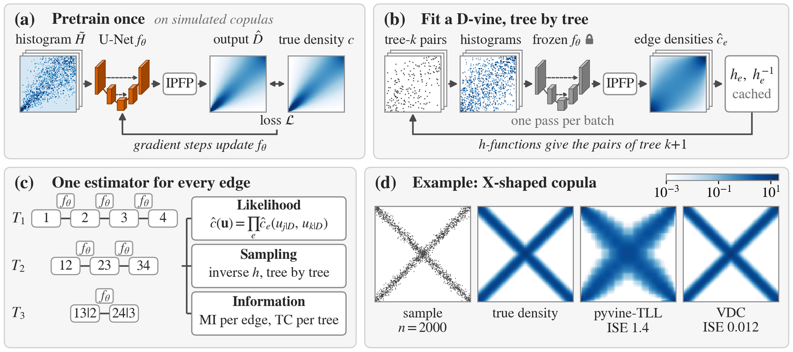
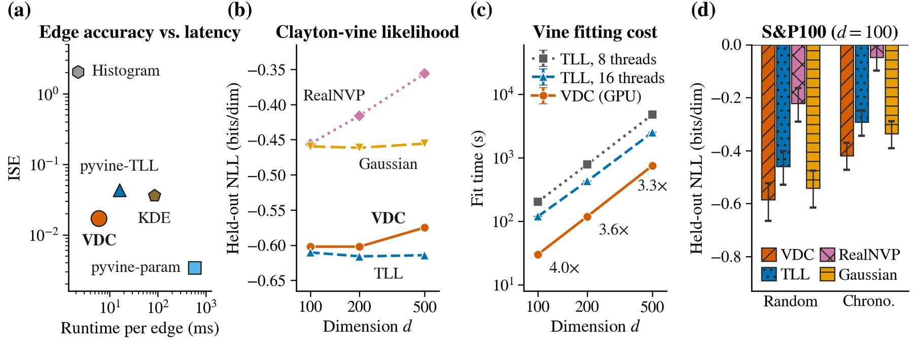
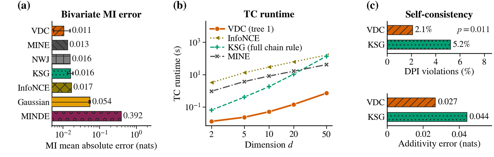

<div align="center">

# Vine Denoising Copula (VDC)

**Amortized vine copulas for high-dimensional density and information estimation**

[](https://github.com/KempnerInstitute/vine-denoising-copula/actions/workflows/ci.yml)
[](https://kempnerinstitute.github.io/vine-denoising-copula/)
[](https://arxiv.org/abs/2604.20568)
[](https://huggingface.co/hsafaai/vdc-denoiser-m64-v1)
[](LICENSE)

[Paper](https://arxiv.org/abs/2604.20568) · [Documentation](https://kempnerinstitute.github.io/vine-denoising-copula/) · [Quick start](#quick-start) · [Pretrained models](#pretrained-models) · [Reproduce the paper](https://github.com/KempnerInstitute/vine-denoising-copula/blob/main/paper/README.md)

</div>



Vine copulas model high-dimensional dependence through a tree of bivariate
**pair-copulas**, but classical fitting estimates every edge separately, which
becomes the bottleneck as dimension grows. **VDC** trains one bivariate
denoising network on simulated copulas and reuses it for every edge: it maps the
empirical histogram of an edge to a density grid in a single forward pass, and
an IPFP (Sinkhorn) projection restores uniform copula marginals. The fitted
pair-copulas and their cached h-functions plug into standard vine recursion, so
the model keeps an explicit, interpretable dependence structure while replacing
repeated per-edge fitting with reusable neural inference.

**What you can do with it**

- Estimate a **bivariate copula density** from samples in milliseconds.
- Fit **D-, C- and regular vines** in high dimensions, with batched GPU inference.
- Evaluate **likelihoods**, draw **samples** (inverse Rosenblatt), and compute
  conditional transforms.
- Estimate **mutual information** and **total correlation**, decomposed by edge
  and by tree of the fitted vine.
- Train your own estimator on the included synthetic copula generators.

## Results at a glance



From the NeurIPS 2026 paper (all numbers use the released `vdc-denoiser-m64-v1`):

| | |
|---|---|
| Bivariate density (9 in-library cases) | lower ISE than histogram, KDE and pyvine-TLL at **~6 ms per edge** on a GPU; parametric family selection is more accurate on its own families at ~100x the cost |
| Families never seen in training | matches per-case TLL refits in held-out likelihood and **roughly halves MI error** |
| High-dimensional vines (d = 100–500) | **3.3–4.0x faster** than 16-thread pyvine-TLL on one node (749 s vs 2,489 s at d = 500) |
| S&P100 daily returns (d = 100) | **best held-out likelihood** of the compared methods on random and chronological splits |
| Information estimation | fewer data-processing-inequality violations and lower additivity error than KSG; TC at d = 50 in **0.71 s** |

Limits are reported alongside: the 64x64 grid bounds accuracy for near-deterministic
pairs, and chained conditional prediction (VaR, imputation) is not yet competitive.
See the paper and [the reproduction guide](https://github.com/KempnerInstitute/vine-denoising-copula/blob/main/paper/README.md) for every protocol.



## Installation

```bash
python -m pip install vine-denoising-copula
```

Python 3.10 or later with PyTorch 2 is required. A GPU is optional. The base
install supports pretrained pair densities, vine fitting, likelihoods and
sampling without pyvinecopulib or plotting/training packages. Optional features:

```bash
python -m pip install 'vine-denoising-copula[train]'      # synthetic data and training
python -m pip install 'vine-denoising-copula[baselines]'  # qualified pyvinecopulib 0.7.x
python -m pip install 'vine-denoising-copula[viz,data]'    # plotting and dataset downloads
```

Install `vine-denoising-copula`, not the unrelated PyPI project `vdc`. Both
provide an `import vdc` namespace, so use separate virtual environments.
Checkpoints remain on Hugging Face and are downloaded and hash-verified on first
use. For a source installation:

```bash
git clone https://github.com/KempnerInstitute/vine-denoising-copula.git
cd vine-denoising-copula
python -m pip install -e '.[dev,train,data,viz]'
```

See [getting started](https://github.com/KempnerInstitute/vine-denoising-copula/blob/main/docs/GETTING_STARTED.md) for CPU/GPU PyTorch installation.
The paper reproduction environment retains its recorded dependency versions.

## Quick start

```python
import numpy as np
from vdc import load_pretrained_model, estimate_pair_density_from_samples, VineCopulaModel

bundle = load_pretrained_model("vdc-denoiser-m64-v1", device="cpu")   # downloads and hash-checks

# 1) a bivariate copula density from pseudo-observations in [0, 1]^2
u = np.random.default_rng(0).uniform(size=(2000, 2))
density = estimate_pair_density_from_samples(bundle, u)              # (64, 64) grid

# 2) a vine on d-dimensional pseudo-observations
x = np.random.default_rng(1).uniform(size=(2000, 8))
vine = VineCopulaModel(vine_type="dvine", m=64, device="cpu", batch_edges=True)
vine.fit(x, bundle.model, diffusion=bundle.diffusion)
loglik = vine.logpdf(x)                      # per-row log copula density
samples = vine.simulate(n=1000)              # inverse-Rosenblatt sampling
```

Pseudo-observations are ranks scaled to (0, 1). Fit marginal transforms on
training rows and apply them to held-out rows. More: [examples/](https://github.com/KempnerInstitute/vine-denoising-copula/tree/main/examples/) and
the [user guide](https://github.com/KempnerInstitute/vine-denoising-copula/blob/main/docs/USER_GUIDE.md).

## Pretrained models

| Model | Grid | Use | Status |
|---|---|---|---|
| [`vdc-denoiser-m64-v1`](https://huggingface.co/hsafaai/vdc-denoiser-m64-v1) | 64x64 | the estimator of all main paper results | released |
| [`vdc-denoiser-m64-v2`](https://huggingface.co/hsafaai/vdc-denoiser-m64-v2) | 64x64 | retrained linear-grid estimator VDC-64 (paper, Appendix G) | released |
| [`vdc-denoiser-m128-v2`](https://huggingface.co/hsafaai/vdc-denoiser-m128-v2) | 128x128 | retrained linear-grid estimator VDC-128 (paper, Appendix G) | released |

Every checkpoint is verified by SHA-256 on load. The v2 estimators were trained after the paper's
main experiments on corrected synthetic data; they use a continuous bilinear density with exact
h-functions and are selected with `VineCopulaModel.from_pretrained(bundle)`. Their training
initialization is published as [`vdc-linear-grid-pilot`](https://huggingface.co/hsafaai/vdc-linear-grid-pilot).
See [docs/MODEL_RELEASES.md](https://github.com/KempnerInstitute/vine-denoising-copula/blob/main/docs/MODEL_RELEASES.md) and [docs/IMPROVED_ESTIMATORS.md](https://github.com/KempnerInstitute/vine-denoising-copula/blob/main/docs/IMPROVED_ESTIMATORS.md).

## Train an estimator

```bash
# the released estimator (vdc-denoiser-m64-v1)
python scripts/train_unified.py --config configs/train/denoiser_cond_enhanced.yaml --model-type denoiser

# the retrained linear-grid estimators: pilot, data cache, then each fine-tune
python scripts/train_linear_grid_estimator.py configs/train/linear_grid_pilot.yaml
python scripts/train_linear_grid_estimator.py configs/train/linear_grid_cache.yaml
python scripts/train_linear_grid_estimator.py configs/train/linear_grid_vdc128_v2.yaml
```

Configurations and the synthetic training generators are documented in
[docs/CONFIGURATION.md](https://github.com/KempnerInstitute/vine-denoising-copula/blob/main/docs/CONFIGURATION.md) and [docs/TRAINING_DATA.md](https://github.com/KempnerInstitute/vine-denoising-copula/blob/main/docs/TRAINING_DATA.md);
the linear-grid recipes, their resources and verification are in [docs/IMPROVED_ESTIMATORS.md](https://github.com/KempnerInstitute/vine-denoising-copula/blob/main/docs/IMPROVED_ESTIMATORS.md).

## Reproduce the paper

[`paper/`](https://github.com/KempnerInstitute/vine-denoising-copula/blob/main/paper/README.md) contains everything needed to reproduce the NeurIPS 2026
results: experiment runners with fixed protocols, the scripts and saved outputs that
regenerate every figure and table, and reference results. Figures and tables
rebuild from saved outputs on a laptop in minutes:

```bash
bash paper/figures/make_figures.sh output/figures
bash paper/tables/make_tables.sh output/tables
```

## Repository layout

```
vdc/        library: models, projection (IPFP), vine fitting, sampling, information, training, data
configs/    training configurations
scripts/    command-line entry points (training, model and dataset downloads, packaging)
examples/   runnable examples
tests/      test suite (run with python -m pytest tests)
docs/       documentation (also served at kempnerinstitute.github.io/vine-denoising-copula)
paper/      NeurIPS 2026 reproduction: runners, figure and table generators, saved results
```

## Citation

```bibtex
@inproceedings{safaai2026vdc,
  title     = {Amortized Vine Copulas for High-Dimensional Density and Information Estimation},
  author    = {Safaai, Houman},
  booktitle = {Advances in Neural Information Processing Systems},
  year      = {2026},
  note      = {arXiv:2604.20568}
}
```

## License

MIT; see [LICENSE](https://github.com/KempnerInstitute/vine-denoising-copula/blob/main/LICENSE). This work was supported in part by a gift from the Chan
Zuckerberg Initiative Foundation to establish the Kempner Institute for the Study of
Natural and Artificial Intelligence at Harvard University.
